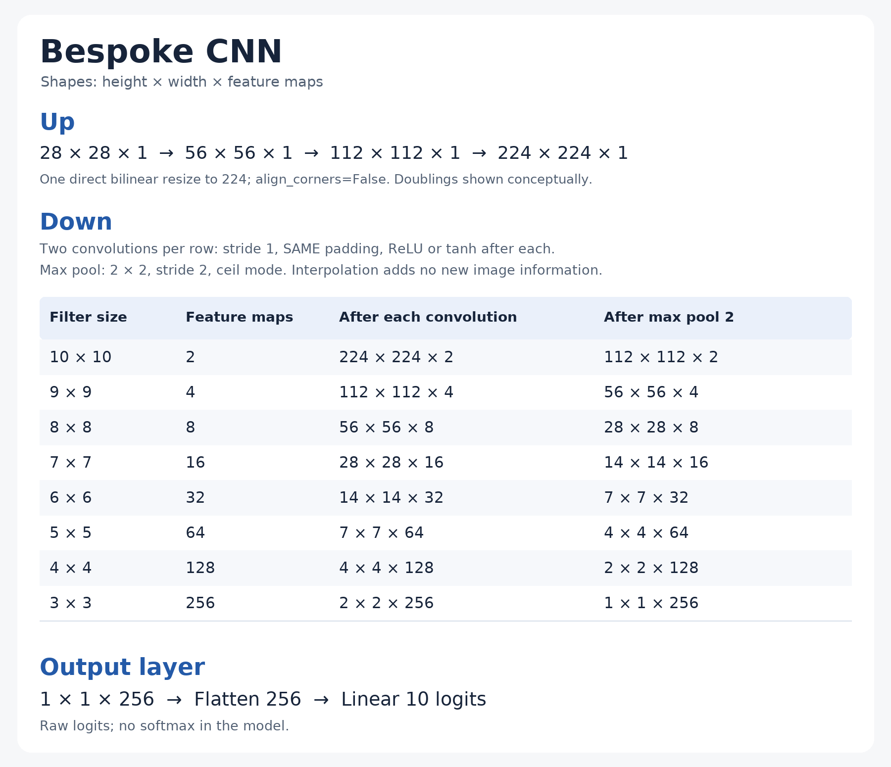

# Bespoke CNN — first activation comparison

**Status:** Complete; a repeat matched weights, logits, labels, and histories exactly.
**Date:** October 29–30, 2026 (America/New_York run timestamps).

**Change / controls:** Eight-stage 224-upsample BespokeCNN, ReLU versus tanh.
Matched seed 42, stratified 80/20 split, batch 64, Adam at 0.001, ten epochs, MPS.
No warm-up or weight decay. Select the lowest-validation-loss checkpoint.

| Activation | Selected epoch | Validation loss | Validation accuracy |
| --- | ---: | ---: | ---: |
| ReLU | 9 | 2.301173 | 11.15% |
| tanh | 10 | 0.062895 | 98.23% |

**Finding:** ReLU predicted 1 for all 8,400 validation images. Tanh was close to
LeNet's 98.24% baseline, with 8,251 correct. This single-seed comparison does not
prove that upsampling helps. No bespoke Kaggle score was measured.

**Next:** Compare learning rates with warm-up; see the
[partial sweep record](bespoke-warmup-sweep.md).

**Run IDs:**

| Activation | First run | Exact repeat |
| --- | --- | --- |
| ReLU | `20261029_220327_ba95689c` | `20261030_002330_03d83c74` |
| tanh | `20261029_223450_f9e9ac62` | `20261030_005533_b5daafba` |

**Artifacts:** For each activation/run ID, paired files are
`data/models/bespoke_{activation}_{run_id}_best.pt` and
`data/validation_outputs/bespoke_{activation}_{run_id}_validation.pt`.
The validation file retains full history, selected logits/labels, configuration,
environment, and dataset/split fingerprints. These files remain local and ignored.

**Provenance:** Captured experiment: `d0556ce`; main merge: `c10d42c`.
The original detailed record, complete epoch tables, and artifact checksums are
retained in Git at `2301b74:docs/evaluations/bespoke-first-run.md`.

